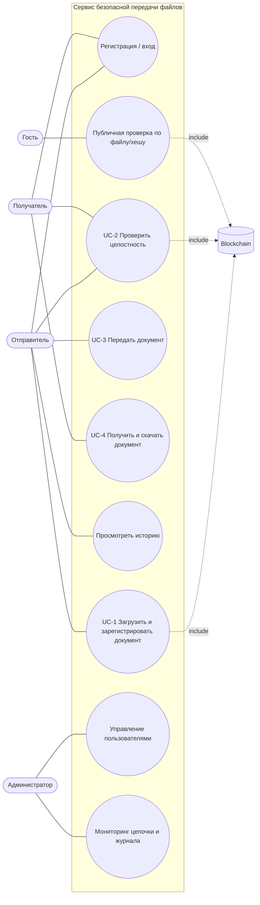
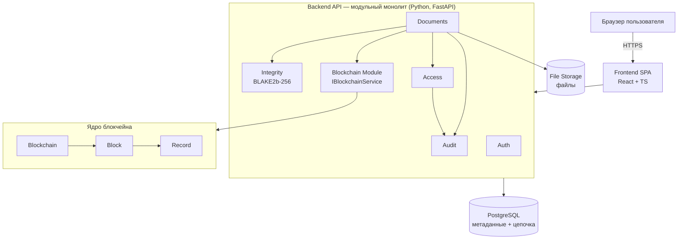
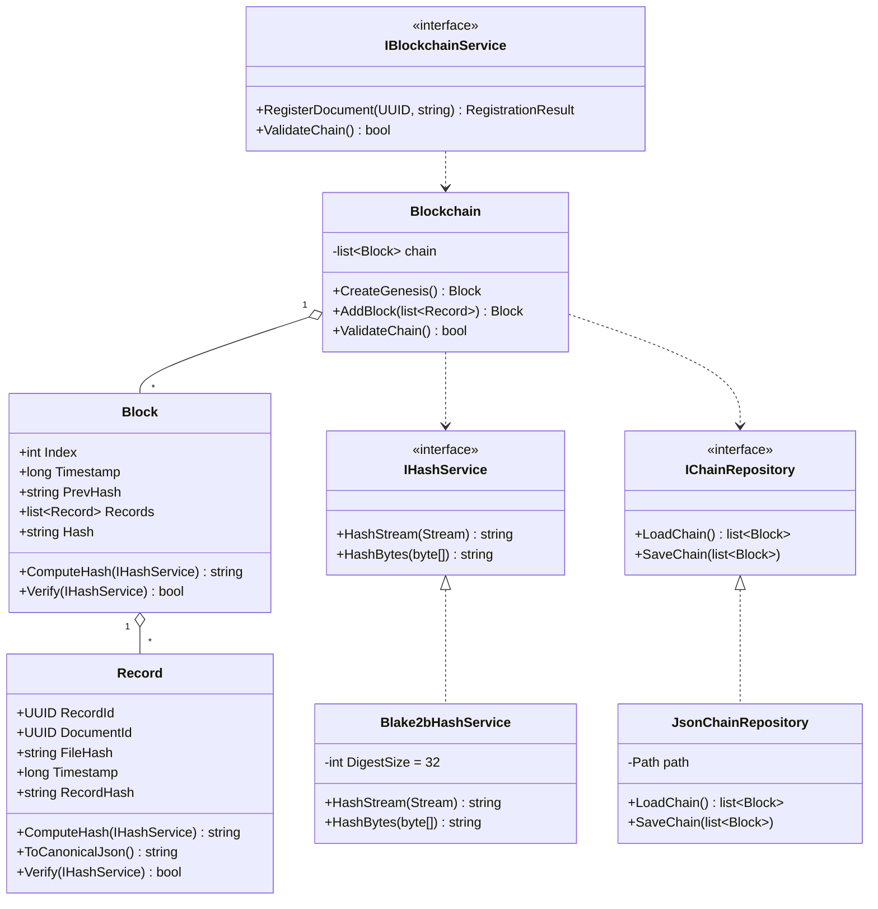
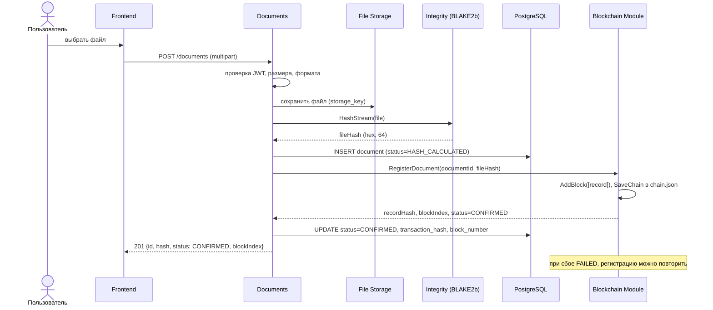
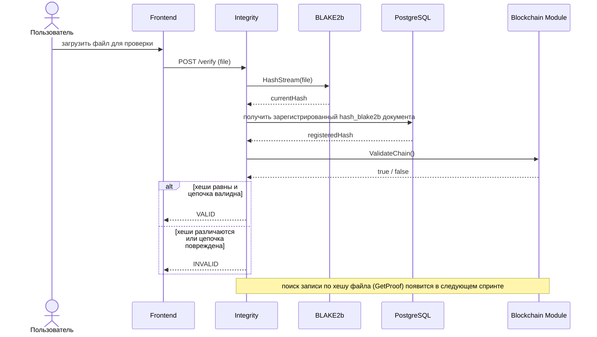

# Диаграммы

Диаграммы написаны на Mermaid: GitHub рисует их прямо в markdown. Для других мест подойдёт https://mermaid.live.

## 1. Use Case диаграмма

## 2. Диаграмма компонентов

## 3. Диаграмма классов ядра

## 4. Диаграмма последовательности: загрузка и регистрация (UC-1)

## 5. Диаграмма последовательности: проверка целостности (UC-2)

